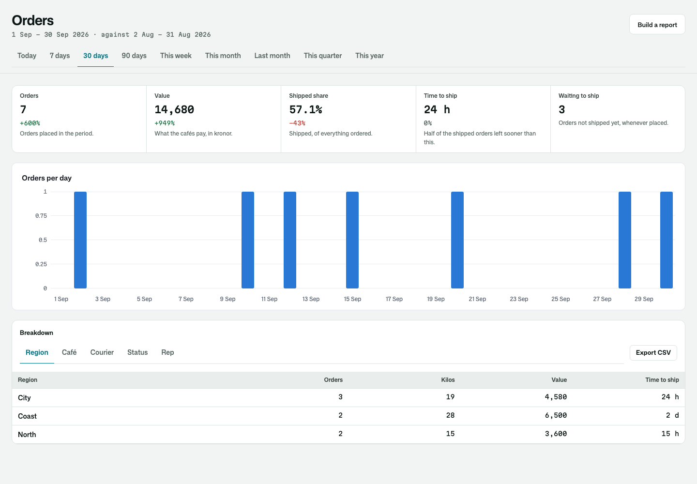
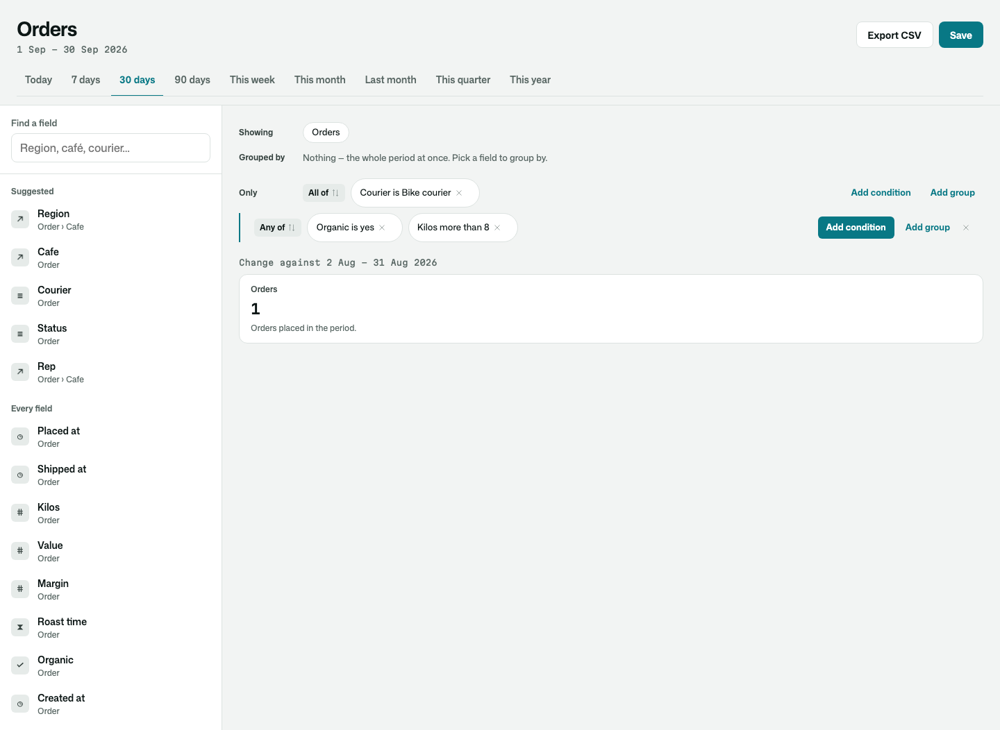
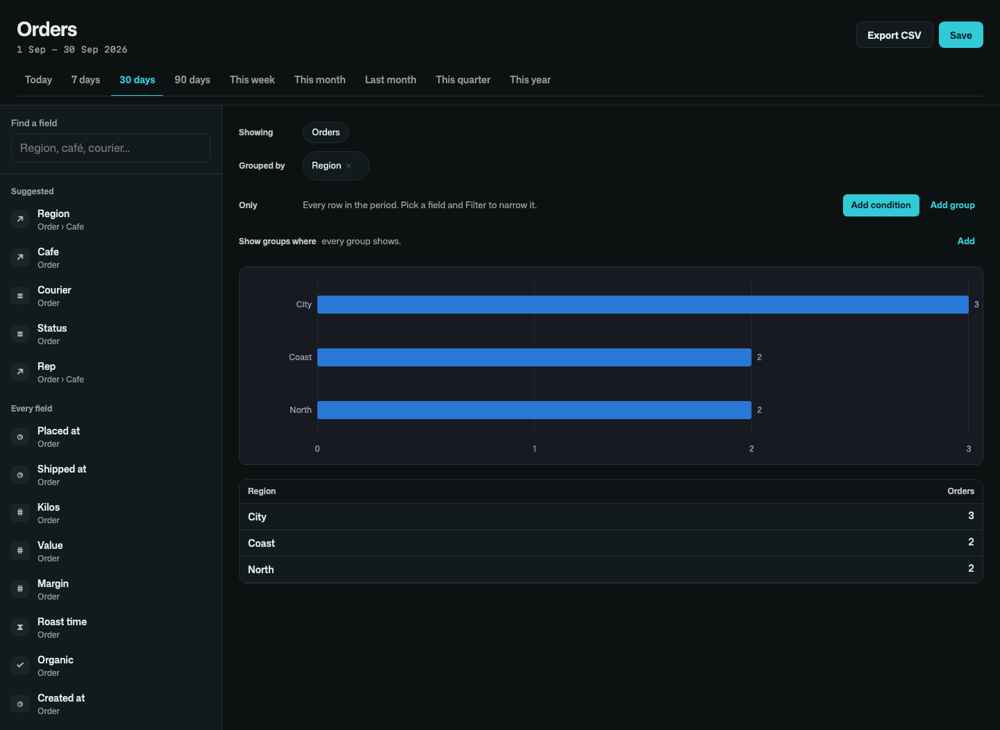
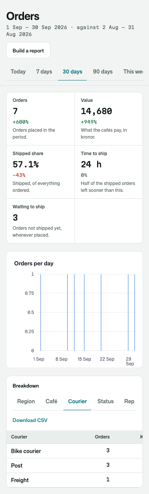

# Osysharp.Reports

Reports your team builds for itself, and the overview it opens every morning. Start from one thing your app keeps (an
order, a ticket, a candidate), pick fields by following its relations (Order › Café › Region), group, measure and
filter, and read the answer as figures, a table and a chart. It updates as you pick. Export it as a CSV that says what
the screen says, and save it by name for yourself or for the whole team.

Every report is computed in the database, as the person reading it may read it. However many orders it covers, a report
reads only the aggregate rows it shows, never the orders themselves.

```osy
use Osysharp.Reports@0;
use Osysharp.Explore;
use Osysharp.Clock@0;               // the time zone a day and a week are counted in

policy ReadsReports => IsStaff;     // who opens reports
policy SharesReports => IsLead;     // who shares a saved report with the team
policy ManagesClock => IsAdmin;     // who sets the app's time zone (Settings › Time and date)

public class OrderReports : IReportSource {
  public ReportSource Describe() {
    var placed = Explore.Path<Order>(o => o.PlacedAt);
    var shipped = Explore.Path<Order>(o => o.ShippedAt);
    return new ReportSource {
      Key = "orders", Title = "Orders", Root = Explore.Root<Order>(), Noun = "order", Nouns = "orders", Date = placed,
      Measures = [
        new ReportMeasure { Label = "Orders", Measure = new ExploreMeasure { Name = "orders" } },
        new ReportMeasure { Label = "Time to ship", Format = FigureFormat.Duration, HigherIsBetter = false,
                            Measure = new ExploreMeasure { Name = "toShip", Kind = MeasureKind.Median, Field = shipped, Since = placed } },
      ],
      Dimensions = [new ReportDimension { Field = Explore.Path<Order>(o => o.Cafe.Region), Label = "Region" }],
      // What "Show the rows" lists of each order a figure counted.
      RowFields = [Explore.Path<Order>(o => o.Cafe), placed],
    };
  }
}

[Page("/reports")] [Authorize(ReadsReports)]
component OrdersOverview() {
  render { ReportOverview("orders", ["orders", "toShip"], build: "/reports/build"); }
}

[Page("/reports/build")] [Authorize(ReadsReports)]
component OrdersBuilder() {
  render { ReportBuilder("orders"); }
}
```

Your app says what it reports on once, in its own words: a class per root, found without being listed. Every other
field a reader may reach from that root is offered too, from your model.

## What it does

| | |
|---|---|
| **Fields by relation** | one root, and every field reachable from it within three steps, with its trail ("Order › Café › Region"). Search across all of them. A path that crosses a collection says so ("one per line") and never counts a row twice |
| **Measures** | count, total, average, median, any percentile (the 90th is one click), count of different values, earliest and latest; a time between two dates (shipped since placed); a share of one count in another. Your app's own measures come first, in its words |
| **Filters you build by pointing** | pick a field and the filter fits its kind: tick choices, pick records with a search, a number or a duration more than, less than or between, a date range in your app's time zone, words that contain or start with, yes or no, empty or not. Conditions read back as sentences ("Courier is Bike courier or Freight"), and nest in "all of" and "any of" groups |
| **Show groups where** | conditions on the groups themselves, by their measures ("cafés with more than ten orders"), kept apart from the conditions on rows |
| **Periods in your time zone** | today, 7, 30 and 90 days, this week, month, quarter and year, last month, or two days you choose. A day, a week and a month start at midnight in the app's time zone, picked from a list in Settings › Time and date (Osysharp.Clock), and follow summer time. A trend has a bar for every day, even a quiet one |
| **The overview** | headline figures with their change against the period before (in the success colour when it is good news, whichever way that is), what stands open now, the trend, and a breakdown by any of your groupings. A figure from a second source joins the breakdown on the grouping of the same name |
| **The rows behind every figure** | press a figure, or a row of a grouped table, and see the rows it counted: "Shipped" for one region lists that region's shipped orders, a day of a trend that day's. Give the source the fields to list (`RowFields`) |
| **CSV** | the same period, the same rows and the same words as the screen, written by one function, so the file and the page cannot disagree |
| **Saved reports** | a report keeps the question, never the numbers. Whoever opens it sees the rows they may read, as they are then. A private one is its owner's; a shared one is everybody's who reads reports |
| **Custom fields as columns** | rows a kit keeps one per record and key, a custom field's answers, are columns of the record: "Ticket › Customer › Their plan" groups, filters and sums as its kind reads. With `Osysharp.Fields` it takes one relation in your model |
| **Only what the reader may read** | a field masked for the reader, or a path into something they may read none of, is never offered, and a saved report naming one says so rather than answering a smaller question. A row they may not read counts for nothing |

| The overview | Filters in nested groups |
|---|---|
|  |  |

| Grouped by a relation, in the dark | On a phone |
|---|---|
|  |  |

## Its tests

The kit's test app is a coffee roaster's wholesale orders: cafés in three regions, a courier, a price list only the
owner may read, and a margin masked from the sales reps. Every figure is checked against an answer worked out by hand:
medians and percentiles, a month in Stockholm across the change to winter time, a week that starts on Sunday, filters
of every kind, nested groups, conditions on groups, the CSV against the screen, saved reports shared and private, and
each reader seeing only their own orders. The builder and the overview are driven as a person would use them, wide and
on a phone, light and dark, with `osy test`, and photographed in a real browser with `osy test --pixels`.
